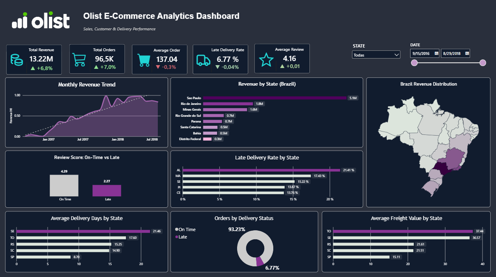
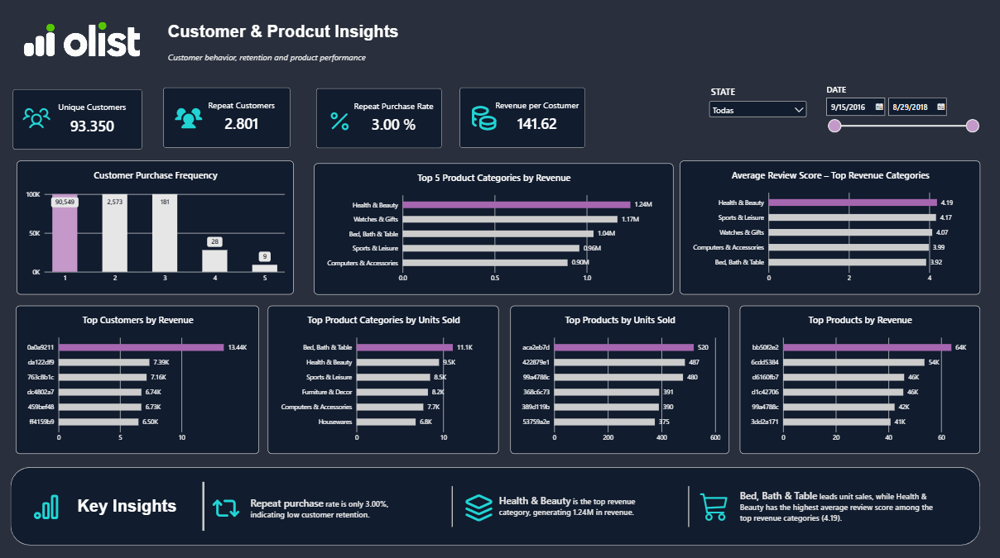

# Olist E-Commerce Analytics

End-to-end **Data Analytics project** analyzing sales performance, customer behavior, product performance, and delivery operations using the Brazilian E-Commerce dataset from Olist.

The project combines **SQL Server for data preparation and analysis** with **Power BI for data modeling, DAX measures, and interactive dashboard development**.

---

## Dashboard Preview

### Sales & Delivery Performance



### Customer & Product Insights



---

## Project Overview

The objective of this project was to transform raw e-commerce transactional data into actionable business insights.

The analysis focuses on four main areas:

- **Sales performance** — revenue, order volume, average order value and geographic performance.
- **Customer behavior** — purchase frequency, repeat customers and revenue per customer.
- **Product performance** — top categories and products by revenue and units sold.
- **Delivery performance** — delivery times, late-delivery rates, freight costs and their impact on customer satisfaction.

The final result is an interactive **two-page Power BI dashboard** designed to help stakeholders monitor performance and identify operational and commercial opportunities.

---

## Key Business Questions

The analysis was designed to answer questions such as:

- How much revenue is the business generating?
- How has revenue evolved over time?
- Which Brazilian states generate the most revenue?
- Which product categories and products perform best?
- How frequently do customers make repeat purchases?
- What percentage of customers purchase more than once?
- Which states experience the highest delivery delays?
- How strongly do late deliveries affect customer reviews?
- Which categories combine strong sales with high customer satisfaction?
- How significant are freight costs across different regions?

---

## Key KPIs

| KPI | Result |
|---|---:|
| Total Revenue | **13.22M** |
| Total Orders | **96.5K** |
| Average Order Value | **137.04** |
| Late Delivery Rate | **6.77%** |
| Average Review Score | **4.16 / 5** |
| Unique Customers | **93.35K** |
| Repeat Customers | **2.80K** |
| Repeat Purchase Rate | **3.00%** |
| Revenue per Customer | **141.62** |

> Dashboard KPIs are based on the curated analytical dataset used in Power BI, focused on delivered orders with valid delivery information where required.

---

## Key Insights

### 1. Customer retention is limited

Only approximately **3% of customers made more than one purchase**, showing that the customer base is heavily dominated by one-time buyers.

This suggests an opportunity to improve retention through loyalty programs, remarketing, personalized offers, or post-purchase campaigns.

### 2. Health & Beauty leads revenue

**Health & Beauty** is the highest-revenue product category, generating approximately **1.24M** in product sales.

Other strong categories include Watches & Gifts, Bed, Bath & Table, and Sports & Leisure.

### 3. Revenue is geographically concentrated

**São Paulo** represents the largest share of revenue by a significant margin, making it the most important geographic market in the dataset.

This concentration highlights the importance of regional demand when evaluating logistics, marketing and commercial strategy.

### 4. Delivery performance has a major impact on customer satisfaction

Orders delivered on time received an average review score of approximately **4.29**, compared with only **2.27** for late deliveries.

The effect becomes stronger as delays increase, indicating a clear relationship between logistics performance and customer experience.

### 5. Late-delivery performance varies considerably by state

Some states show late-delivery rates significantly above the national average of **6.77%**.

This suggests that delivery performance is not uniform across Brazil and that regional logistics should be investigated independently.

### 6. Product volume and customer satisfaction do not always move together

High-volume categories do not necessarily receive the highest customer ratings.

Combining revenue, sales volume and review scores provides a more complete view of product performance than analyzing sales alone.

---

## Tools & Technologies

### SQL Server / SSMS

Used for:

- Importing and staging raw CSV files
- Data cleaning and validation
- Data type correction
- Duplicate detection
- Referential-integrity checks
- Business KPI calculations
- Sales analysis
- Customer analysis
- Product analysis
- Delivery analysis
- Creation of analytical views for Power BI

### Power BI

Used for:

- Data modeling
- Calendar/date modeling
- DAX measures
- KPI development
- Geographic analysis
- Interactive filtering
- Conditional formatting
- Data visualization
- Dashboard design

### DAX

Examples of calculated metrics include:

- Total Revenue
- Total Orders
- Average Order Value
- Late Delivery Rate
- Average Review Score
- Unique Customers
- Repeat Customers
- Repeat Purchase Rate
- Revenue per Customer
- Previous-period comparisons
- KPI growth indicators

---

## Data Preparation

The original dataset contains multiple related CSV files covering customers, orders, order items, products, sellers, payments, reviews, category translations and geolocation.

The raw files were first imported into **staging tables** in SQL Server before creating the analytical layer.

### Main data-quality checks

The preparation process included:

- Primary-key duplicate checks
- Null-value analysis
- Referential-integrity validation
- Invalid numeric-value checks
- Missing product-category analysis
- Missing category-translation analysis
- Review-score validation
- Delivery-date validation
- Payment validation
- Geolocation duplicate analysis

No orphan records were found across the primary transactional relationships used in the analysis.

---

## Important Analytical Decisions

### Customer identification

The dataset contains both `customer_id` and `customer_unique_id`.

`customer_id` identifies a customer record associated with an individual order, while `customer_unique_id` is used to identify the same customer across multiple purchases.

For customer retention and repeat-purchase analysis, **`customer_unique_id` was therefore used as the customer identifier**.

### Late delivery definition

A delivery is classified as late when the actual delivery **date** occurs after the estimated delivery **date**.

```sql
CAST(order_delivered_customer_date AS DATE)
>
CAST(order_estimated_delivery_date AS DATE)
```

Comparing dates rather than full timestamps prevents deliveries completed later on the estimated delivery day from being incorrectly classified as late.

### Missing product categories

Products with missing category information were retained rather than removed.

The analytical views use a fallback strategy to preserve those transactions:

```sql
COALESCE(
    product_category_name_english,
    product_category_name,
    'Unknown'
)
```

---

## SQL Analysis

The SQL portion of the project is divided into focused scripts.

### `01_database_setup.sql`
Creates the final analytical tables and prepares the database structure.

### `02_data_quality_checks.sql`
Performs null checks, duplicate checks, referential-integrity validation and other data-quality tests.

### `03_sales_analysis.sql`
Analyzes:

- Total revenue
- Order volume
- Average order value
- Monthly revenue trends
- Revenue by state
- Seller performance
- Freight contribution

### `04_customer_analysis.sql`
Analyzes:

- Unique customers
- Repeat customers
- Purchase frequency
- Repeat purchase rate
- Revenue per customer
- Customer segmentation
- Cohort behavior

### `05_product_analysis.sql`
Analyzes:

- Top categories by revenue
- Top categories by units sold
- Top products
- Average product prices
- Review performance
- High-sales / low-rating products

### `06_delivery_analysis.sql`
Analyzes:

- Delivery times
- Late-delivery rates
- Delivery performance by state
- Delay severity
- Review scores for on-time vs. late orders
- Relationship between delivery delays and customer satisfaction

### `07_powerbi_dataset.sql`
Creates the main **order-level analytical view** used by Power BI.

### `08_powerbi_product_dataset.sql`
Creates the **order-item-level product view** used for product analytics in Power BI.

---

## Power BI Dashboard

The final Power BI report contains two analytical pages.

### Page 1 — Sales & Delivery Performance

Focuses on executive-level commercial and operational performance.

Visuals include:

- Total Revenue
- Total Orders
- Average Order Value
- Late Delivery Rate
- Average Review Score
- Monthly Revenue Trend
- Revenue by State
- Brazil Revenue Distribution
- On-Time vs. Late Review Score
- Late Delivery Rate by State
- Average Delivery Days by State
- Orders by Delivery Status
- Average Freight Value by State

Interactive filters allow the dashboard to be analyzed by **state and date**.

---

### Page 2 — Customer & Product Insights

Focuses on customer behavior and product performance.

Visuals include:

- Unique Customers
- Repeat Customers
- Repeat Purchase Rate
- Revenue per Customer
- Customer Purchase Frequency
- Top Product Categories by Revenue
- Average Review Score by Top Revenue Category
- Top Customers by Revenue
- Top Product Categories by Units Sold
- Top Products by Units Sold
- Top Products by Revenue
- Key Business Insights

---

## Data Model

Power BI uses two primary analytical views:

### `vw_powerbi_orders`

Order-level dataset used for:

- Revenue
- Customers
- Delivery performance
- Geography
- Reviews
- Time-based analysis

### `vw_powerbi_products`

Order-item-level dataset used for:

- Product categories
- Product revenue
- Units sold
- Product rankings
- Review analysis

A dedicated **Calendar table** is connected to the order data to support time intelligence and previous-period KPI comparisons.

---

## Project Structure

```text
olist-ecommerce-analytics/
│
├── README.md
│
├── sql/
│   ├── 01_database_setup.sql
│   ├── 02_data_quality_checks.sql
│   ├── 03_sales_analysis.sql
│   ├── 04_customer_analysis.sql
│   ├── 05_product_analysis.sql
│   ├── 06_delivery_analysis.sql
│   ├── 07_powerbi_dataset.sql
│   └── 08_powerbi_product_dataset.sql
│
├── powerbi/
│   └── olist_ecommerce_dashboard.pbix
│
├── images/
│   ├── dashboard_overview.png
│   └── customer_product_insights.png
│
└── data/
    └── README.md
```

---

## How to Reproduce the Project

1. Download the **Brazilian E-Commerce Public Dataset by Olist** from Kaggle.
2. Import the raw CSV files into SQL Server staging tables.
3. Run the SQL scripts sequentially:

```text
01_database_setup.sql
02_data_quality_checks.sql
03_sales_analysis.sql
04_customer_analysis.sql
05_product_analysis.sql
06_delivery_analysis.sql
07_powerbi_dataset.sql
08_powerbi_product_dataset.sql
```

4. Connect Power BI to SQL Server.
5. Load:
   - `vw_powerbi_orders`
   - `vw_powerbi_products`
6. Create the Calendar table and relationships.
7. Build the required DAX measures.
8. Open or recreate the dashboard using the provided `.pbix` file.

---

## Dataset

**Brazilian E-Commerce Public Dataset by Olist**

The dataset contains transactional e-commerce information covering customers, orders, products, sellers, payments, reviews, freight and geographic information.

The original raw dataset is not included in this repository. It can be obtained from the original Olist dataset published on Kaggle.

---

## Skills Demonstrated

This project demonstrates practical experience in:

- SQL
- SQL Server
- Data Cleaning
- Data Quality Validation
- Relational Data Modeling
- Exploratory Data Analysis
- Business Analysis
- KPI Development
- DAX
- Power BI
- Data Visualization
- Dashboard Design
- Customer Analytics
- Product Analytics
- Sales Analytics
- Logistics Analytics
- Business Insight Communication

---

## Future Improvements

Potential extensions of the project include:

- Customer cohort retention analysis directly in Power BI
- RFM segmentation visualization
- Seller-performance analysis
- Freight-cost optimization analysis
- Product profitability analysis
- Drill-through pages for individual states or categories
- Additional time-intelligence comparisons
- Automated SQL-to-Power BI refresh workflow

---

## About This Project

This project was developed as part of my **Data Analytics / Data Science portfolio** to demonstrate the complete analytical workflow: from raw transactional data and SQL transformation to business analysis and an interactive Power BI dashboard.

The emphasis is not only on visualization, but on **data quality, analytical reasoning, KPI definition and communicating business-relevant insights**.

---

## Contact

If you would like to discuss this project or my work:

- **LinkedIn:** [Add LinkedIn profile]
- **Portfolio:** [Add portfolio URL]
- **GitHub:** [Add GitHub profile]